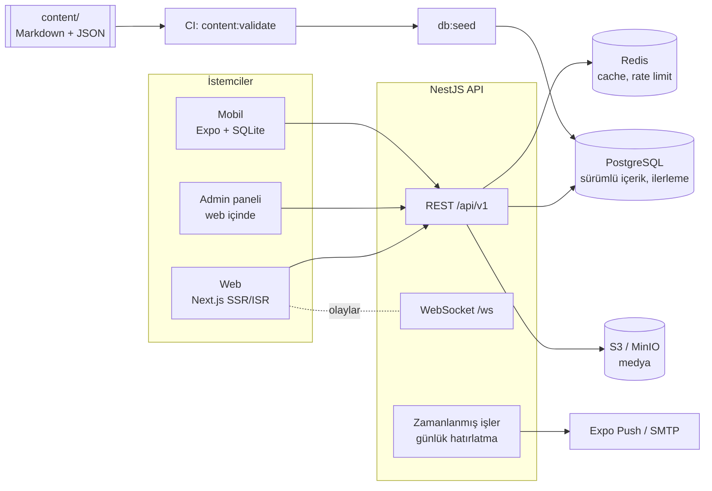
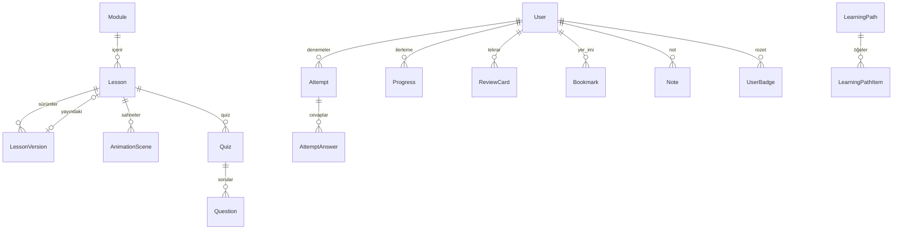

# DevAcademy Mimarisi

Bu belge sistemin bileşenlerini, veri akışlarını ve tasarım kararlarını özetler. Aynı içerik uygulamada **F-08 DevAcademy’nin Kendi Mimarisi** dersinde animasyonlu olarak anlatılır.

## Bileşenler

### packages/shared

| Modül           | İçerik                                                                                                                                                                                                                                                                                                                                                                                                                                                                          |
| --------------- | ------------------------------------------------------------------------------------------------------------------------------------------------------------------------------------------------------------------------------------------------------------------------------------------------------------------------------------------------------------------------------------------------------------------------------------------------------------------------------- |
| `scene/`        | `AnimationSceneSchema` (zod), anlamsal doğrulama (`validateScene`), oynatıcı durum makinesi (`playerReducer`), adım görünümü çözümleme (`resolveStepView`, inherit zinciri), paket konumları (`computePackets`), geometri (kenar Bézier eğrileri)                                                                                                                                                                                                                               |
| `content/`      | Ders frontmatter, blok birleşimi (`LessonBlock`), quiz, modül/yol şemaları; Markdown directive ayrıştırıcısı; müfredat ağacı                                                                                                                                                                                                                                                                                                                                                    |
| `simulators/`   | Load balancer, cache (LRU/LFU/FIFO, TTL, yazma politikaları), rate limiter (5 algoritma), consistent hashing, gradient descent, self-attention, kapasite tahmini — saf fonksiyonlar. Web'e özgü 40 simülatörün (sıralama, graf gezintisi, hash tablosu, DP tablosu, heap, yığın ve kuyruk, Big-O, RAG hattı, prompt oyun alanı, token maliyeti, OAuth akışı, JWT inceleyici, kaba kuvvet modeli, git grafiği…) saf mantığı `web/src/components/simulators/*.logic.ts` içindedir |
| `api/`          | İstek/yanıt tipleri ve zod şemaları                                                                                                                                                                                                                                                                                                                                                                                                                                             |
| `gamification/` | Seri hesaplama (saat dilimine duyarlı) ve seri dondurma, XP kuralları ve seviye eğrisi (`xp.ts`), SM-2 aralıklı tekrar, rozet koşulları, quiz puanlama                                                                                                                                                                                                                                                                                                                          |
| `node/`         | `content/` klasörü yükleyicisi (doğrulama scripti ve seed ortak kullanır)                                                                                                                                                                                                                                                                                                                                                                                                       |

### Backend modülleri

| Modül         | Uç noktalar                                                                                                           | Not                                                                                                                                                            |
| ------------- | --------------------------------------------------------------------------------------------------------------------- | -------------------------------------------------------------------------------------------------------------------------------------------------------------- |
| auth          | `/auth/register`, `/login`, `/oauth`, `/refresh`, `/logout`, `/change-password`, `/forgot`, `/reset`, `/verify-email` | argon2id; refresh token rotasyonu ve yeniden kullanım tespiti; Google/Apple ID token doğrulama; tek kullanımlık, özeti saklanan sıfırlama/doğrulama token'ları |
| users         | `/users/me` (GET/PATCH/DELETE), `/users/me/push-tokens` (POST, DELETE `/:token`)                                      | profil, öğrenme yolu, hatırlatma saati, doğrulanmış saat dilimi; hesabı ve kişisel verileri kalıcı silme (KVKK); push token başka hesaba devredilemez          |
| content       | `/paths`, `/modules`, `/lessons`, `/scenes`                                                                           | yalnızca yayınlanmış sürümler; Redis cache + ETag; token varsa ilerleme eklenir                                                                                |
| quizzes       | `/quizzes/by-lesson/:id`, `/quizzes/:id/attempts`                                                                     | doğru cevaplar istemciye gönderilmez; yanlışlar SM-2 kartına dönüşür                                                                                           |
| progress      | `/progress`, `/summary`, `/lessons/:id`, `/reviews`, `/badges`, `/interactive`, `/activity`, `/xp`                    | seri (dondurma hakkıyla), XP/seviye, günlük hedef ve aktivite, rozet, tekrar takvimi; WebSocket bildirimleri (`xp.updated`, `certificate.issued`)              |
| certificates  | `/certificates`, `/certificates/public/:publicId`                                                                     | modül/yol tamamlanınca otomatik üretilir; herkese açık doğrulama sayfası                                                                                       |
| feedback      | `/lessons/:id/feedback` (GET/POST)                                                                                    | ders sonu 👍/👎, zorluk ve yorum; admin analitiğinde toplanır                                                                                                  |
| exams         | `/exams`, `/exams/:id`, `/exams/:id/submit`                                                                           | mülakat modu: deterministik-rastgele karışık sorular, süre, kavram/modül kırılımı, yanlışlar tekrar kartına                                                    |
| library       | `/bookmarks`, `/notes`                                                                                                |                                                                                                                                                                |
| search        | `/search?q=`                                                                                                          | önce PostgreSQL full-text (GIN indeksi), sonuç yoksa ILIKE alt dize yedeği; modül başlıkları iki dilde                                                         |
| admin         | `/admin/lessons`, `/versions`, `/scenes`, `/quizzes`, `/modules`, `/media/presign`, `/stats`, `/analytics`            | editor/admin; taslak → yayın akışı; ders analitiği; `POST /admin/lessons/:id/export` (admin) dersi `content/` dosyalarına çevirir (CLI: `pnpm content:export`) |
| offline       | `/offline/modules/:id`                                                                                                | mobil için modül paketi (ETag destekli)                                                                                                                        |
| health        | `/health`, `/health/ready`                                                                                            | liveness / readiness                                                                                                                                           |
| metrics       | `/metrics`                                                                                                            | Prometheus kazıma uç noktası (prefix dışında); `METRICS_ENABLED=false` ile 404                                                                                 |
| notifications | `/notifications/run-daily` (admin)                                                                                    | saatlik zamanlanmış iş: yerel hatırlatma saatinde Expo push ya da e-posta                                                                                      |
| realtime      | WebSocket `/ws`                                                                                                       | socket.io; kullanıcı odası (ilerleme, seri, rozet olayları), `content.published` yayını, kimliği doğrulanmış simülasyon odaları                                |

Ortak altyapı: global JWT guard (`@Public`, `@OptionalAuth`), rol guard’ı, Redis tabanlı rate limiting, zod doğrulama pipe’ı (shared şemalarıyla), merkezi hata formatı (`ApiErrorBody`), pino yapılandırılmış log ve request-id, OpenAPI (`/docs`).

## Veri modeli

- **Sürümleme**: `LessonVersion.status` = `draft | published | archived`. Bir derste aynı anda en fazla bir yayın sürümü vardır; `Lesson.publishedVersionId` onu gösterir.
- **Bloklar**: `LessonVersion.blocks` JSON’dur ve shared `LessonBlock` şemasıyla doğrulanır. Seed sırasında SVG’ler bloğa gömülür, sahne/quiz dosya adları kimliklere çözülür.

## Ana akışlar

### İçerik okuma (cache)

1. İstemci `GET /lessons/:id` (varsa `If-None-Match`).
2. API Redis’e bakar (`content:lesson:<id>`); yoksa PostgreSQL’den okur, Redis’e yazar (6 saat TTL).
3. Yanıta zayıf ETag eklenir; eşleşirse 304 döner.
4. Kullanıcıya özel ilerleme bilgisi cache’lenmeden eklenir; token’lı isteklerde yanıt `Cache-Control: private` ve `Vary: Authorization` ile döner, böylece CDN/proxy’de saklanmaz.
5. Yayınlama anında `content:*` anahtarları ve arama cache’i silinir, `content.published` olayı yayınlanır.

### Quiz → aralıklı tekrar

1. İstemci cevapları gönderir; puanlama sunucuda yapılır.
2. Yanlış cevaplanan her soru için `ReviewCard` oluşturulur ya da sıfırlanır (SM-2, kalite 1); doğru cevaplanan ve kartı olan sorular ilerletilir. Deneme ve kartlar tek transaction’da yazılır. Quizden çıkarılan sorular silinmez, `archived` olarak işaretlenir: öğrenciye gösterilmez ama deneme ve tekrar geçmişi korunur.
3. Aktivite kaydedilir: seri güncellenir, rozet koşulları değerlendirilir, WebSocket ile bildirilir.

### Mobil offline

1. Kullanıcı bir modülü indirir: `GET /offline/modules/:id` (ETag ile).
2. Dersler, sahneler ve quizler SQLite’a yazılır (modül başına ETag ve `synced_at` dahil); son senkron zamanı expo-sqlite/kv-store’da.
3. Çevrimdışıyken içerik SQLite’tan okunur; ilerleme güncellemeleri kuyruğa alınır, bağlantı gelince gönderilir.

## Ölçekleme notları

- API stateless’tır (oturum JWT’de). socket.io Redis adapter’ı bağlıdır: bir replikadan yayınlanan olay diğer replikalara bağlı soketlere de ulaşır. WebSocket CORS’u HTTP ile aynı `CORS_ORIGINS` listesini kullanır. Mobil uygulama WebSocket kullanmaz.
- Saatlik hatırlatma işi her replikada tetiklenir ama saat başına Redis kilidini (`SET NX PX`) yalnızca biri alır; kopya bildirim gönderilmez.
- Rate limit sayaçları Redis’te tutulduğu için tüm replikalar aynı limiti uygular; Redis yoksa replika başına bellek içi sayaca düşer.
- Okuma ağırlıklı içerik için Redis + ETag + Next.js ISR; yazma ağırlıklı ilerleme için istemci tarafında toplu gönderim (web 5 sn aralık, mobil her %10 artışta ve ekrandan çıkışta).
- İzleme: `GET /metrics` (prefix dışında, JWT ve rate limit muaf) Prometheus biçiminde Node süreç metriklerini, `http_requests_total` / `http_request_duration_seconds` (etiketler: method, Express route deseni, status), `ws_connections_active` ve içerik cache’i için `cache_lookups_total{result="hit|miss"}` sayaçlarını verir; `METRICS_ENABLED=false` ile kapanır. Metrikler replika başınadır; uç nokta ters vekilde iç ağa sınırlanmalıdır.
- Hata izleme isteğe bağlıdır: `SENTRY_DSN` verilirse `src/instrument.ts` Sentry’yi uygulama yüklenmeden başlatır ve global hata filtresi yalnızca 5xx hataları (istek kimliğiyle) gönderir; DSN yoksa Sentry paketi hiç yüklenmez.
- Medya dosyaları S3’e ön imzalı POST formuyla doğrudan yüklenir (tür ve boyut sınırı depolama tarafında zorlanır, SVG kabul edilmez); API dosya trafiği taşımaz.
